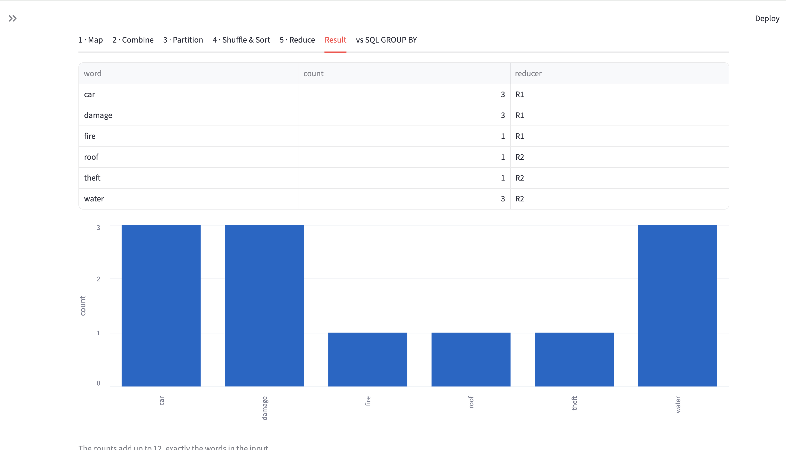

# Bonus Assignment - Build Your MapReduce (5 marks)

**CIS 41 03 - Big Data Analytics - Lecture 06: Processing Big Data: Hadoop & MapReduce**

Student: **Mahmoud Khaled Mahmoud Yassin Badr** - ID: **231005511**

A small **MapReduce-like engine** written from scratch in plain Python.
**No Hadoop, no Spark**: the five phases are built by hand.

**Map -> Combine -> Partition -> Shuffle & Sort -> Reduce**

## 1. How to run

```bash
jupyter notebook bonus_mapreduce.ipynb    # then: Cell -> Run All
```

or without opening it:

```bash
jupyter nbconvert --to notebook --execute --inplace bonus_mapreduce.ipynb
```

Nothing to install: **standard library only** (`os`, `re`, `shutil`, `time`, `threading`,
`concurrent.futures`, `sqlite3`). Runs the same in Google Colab.

### The Streamlit UI (extra)

The same engine also runs behind a small web UI, which shows every phase on its own tab:

```bash
pip install streamlit
streamlit run app.py
```

| File | What it is |
|---|---|
| `bonus_mapreduce.ipynb` | the assignment: the five phases, built and explained one at a time |
| `mapreduce_engine.py` | the same five functions in one importable file |
| `app.py` | the Streamlit UI on top of `mapreduce_engine.py` |

The UI lets you change the number of reducers, switch the combiner off, upload your own `.txt`
splits, and download the `part-0000N` files.

Running it creates this folder next to the notebook:

```
mapreduce_job/
  claims/       the input splits (one text file = one split)
  output/       part-00000, part-00001   (one file per reducer)
```

## 2. Where each mark is proved

| # | Marking scheme | Where it is in the notebook | Evidence |
|---|---|---|---|
| 1 | Map emits correct `(key, value)` pairs | section 2, `map_function` | `"car fire car damage"` -> `(car,1) (fire,1) (car,1) (damage,1)` |
| 2 | Mappers run in parallel on the splits | section 5, `map_task` + `ThreadPoolExecutor` | 3 mappers, 0.3 s each, **wall time about 0.3 s**, not 0.9 s; each mapper prints its own thread name |
| 3 | Combiner + partitioner to 2 reducers | sections 3 and 4, `combine_function`, `partition_function` | combine: 4 pairs -> 3 pairs on the mapper's own node; partition: words **a-f -> Reducer 1**, **g-z -> Reducer 2** |
| 4 | Shuffle & sort + reduce give correct totals | sections 6, 7, 8 | `car -> [2,1]`, `damage -> [1,1,1]`; the 2 reducers run in their own threads; totals match the lecture, and `assert` fails the run if they do not |
| 5 | README: how to run, sample input/output, screenshot | this file | sections 1, 3, 4 and 6 below, with `result.png` |

## 3. Sample input

A folder of text files. **Each file is one split**, and each split gets its own mapper running at the
same time in its own thread. The input is the 3 ETI claim notes from the lecture walk-through:

```
mapreduce_job/claims/note_01.txt    car fire car damage
mapreduce_job/claims/note_02.txt    water roof water damage
mapreduce_job/claims/note_03.txt    car theft water damage
```

12 words in total.

## 4. Sample output

One output file per reducer, exactly as MapReduce writes `part-00000`, `part-00001`:

```
$ cat mapreduce_job/output/part-00000     $ cat mapreduce_job/output/part-00001
car     3                                 roof    1
damage  3                                 theft   1
fire    1                                 water   3
```

`3 + 3 + 1 + 1 + 1 + 3 = 12`, exactly the 12 words of the input.

### Self-check (required numbers)

```
car 3    damage 3    fire 1    roof 1    theft 1    water 3
```

Same numbers as the lecture walk-through and Lab 06. The notebook checks them two ways:

* an `assert` against the expected dictionary (the run fails loudly if a count is wrong);
* a `sqlite3` `SELECT word, COUNT(*) ... GROUP BY word` over the same words, printed side by side -
  `same answer: True`.

## 5. The phases, and the one rule

| Phase | Function | What it does |
|---|---|---|
| 1 - Map | `map_function` | emits `(word, 1)` for every word in the record |
| 2 - Combine | `combine_function` | mini-reducer on the mapper's own node: local subtotals before the network |
| 3 - Partition | `partition_function` | one partition per reducer, 2 reducers: a-f -> R1, g-z -> R2; same key always to the same reducer |
| 4 - Shuffle & Sort | `shuffle_and_sort` | copies each reducer's partitions from every mapper, groups and sorts them `key -> list of values` |
| 5 - Reduce | `reduce_function` | sums each list, writes one output file per reducer |

* **Map task** = map -> combine -> partition. **Reduce task** = shuffle & sort -> reduce.
* The mappers are started with a `ThreadPoolExecutor`, **one worker per split**, so they run at the
  same time. The printed thread names and the wall time show the overlap.
* The **reducers run in threads too**, one worker per reducer, in section 7 and inside the engine.
* `mapreduce(input_dir, output_dir, num_reducers)` in section 9 is the whole engine in one function,
  and works on any folder of text files with any number of reducers. It writes no new logic: it only
  calls `map_function`, `combine_function`, `partition_function`, `shuffle_and_sort` and `reduce_task`.
* Threads here stand in for what a real cluster does with separate processes on separate nodes.
  Swapping `ThreadPoolExecutor` for `ProcessPoolExecutor` is a one-word change; the assignment allows
  either.

**The one rule is respected:** the grouping and counting are all own code - plain dicts and loops.
**No `collections.Counter`, no `itertools.groupby`, no `pandas`.** `sqlite3` appears only in section 10,
as an independent cross-check of the result, never to compute it.

### Why the combiner is safe here

Word count is a **sum**, and a sum can be done in pieces. A combiner is **not** safe for an **average**:
it sees only part of the data, and an average of averages is wrong.

## 6. Result

The full result of the job, every word with its count and the reducer that wrote it:

| word | count | reducer |
|---|---|---|
| car | 3 | R1 (a-f) |
| damage | 3 | R1 (a-f) |
| fire | 1 | R1 (a-f) |
| roof | 1 | R2 (g-z) |
| theft | 1 | R2 (g-z) |
| water | 3 | R2 (g-z) |

`3 + 3 + 1 + 1 + 1 + 3 = 12`, the 12 words of the input, computed by our own map, shuffle and reduce
functions - not by `Counter`.

### Screenshot



## 7. Submission

Forked `github.com/dr-ahmed-said/Big-Data-Analytics`, code + README added in
`submissions/Lecture-06/231005511/`, pull request opened before the discussion.
Individual work.
